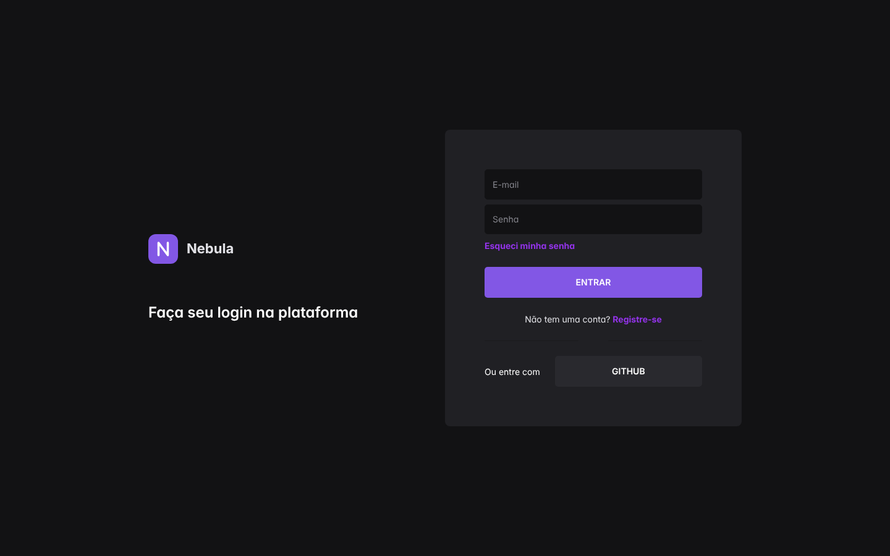

<div align="center">
  <h1>Nebula Design System</h1>
  <p>Design system em Next.js e Chakra UI: tema customizado, componentes reutilizáveis e uma tela de login de exemplo.</p>
</div>

<p align="center">
  
</p>

## O que tem aqui

- **Tema** (`styles/theme.ts`): fonte Roboto, raios de borda e paleta escura com roxo `#8257e5`, definidos como tokens do Chakra.
- **Componentes** (`components/`): `Input` e `Divider`, wrappers do Chakra com o estilo do design system já aplicado.
- **Página de login** (`pages/index.tsx`): exemplo de uso do tema e dos componentes.
- **Dark mode fixo** via `next-themes`.

## Stack

Next.js 16 (Pages Router), React 19, TypeScript 7 e Chakra UI 3.

## Rodando

Requer [Node.js](https://nodejs.org) 20+ e [Yarn](https://yarnpkg.com).

```bash
git clone https://github.com/fidelis27/nebula-design-system
cd nebula-design-system
yarn install
yarn dev        # http://localhost:3000
```

Build de produção: `yarn build && yarn start`.

## Notas da migração para o Chakra v3

O projeto nasceu em 2020 (Next 9, Chakra 0.8) a partir de um [tutorial em vídeo](https://www.youtube.com/watch?v=6TEo2AxW-oQ) e foi atualizado. O que mudou:

- `theme.ts` agora usa `createSystem(defaultConfig, defineConfig({ theme: { tokens } }))`, com valores no formato `{ value: '...' }`.
- `Divider` virou `Separator`; `flexDir` virou `flexDirection`; `focusBorderColor` virou a variável CSS `--focus-color`.
- Botões precisam de `color="white"` explícito, porque o Chakra v3 não calcula mais o contraste do texto sozinho.
- `emotion-theming` e `@emotion/styled` foram removidos.
